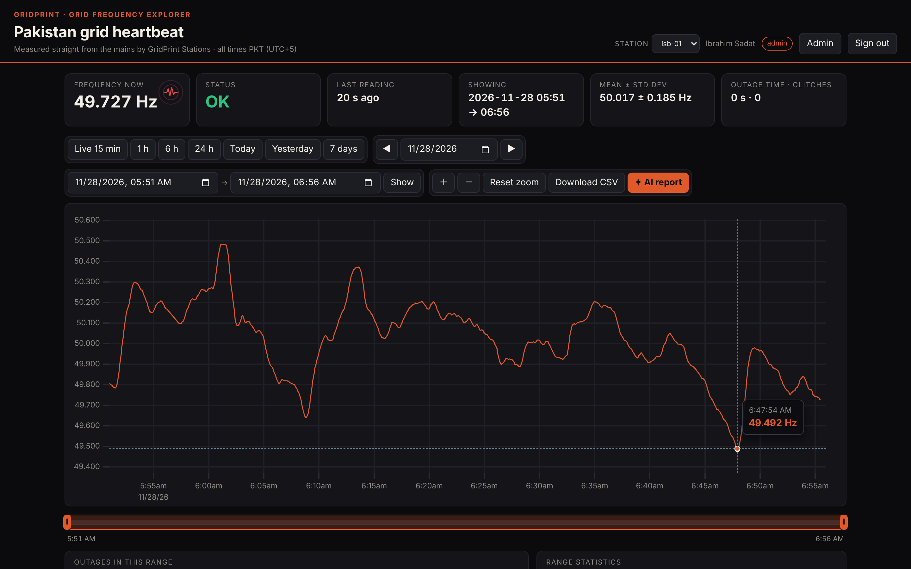
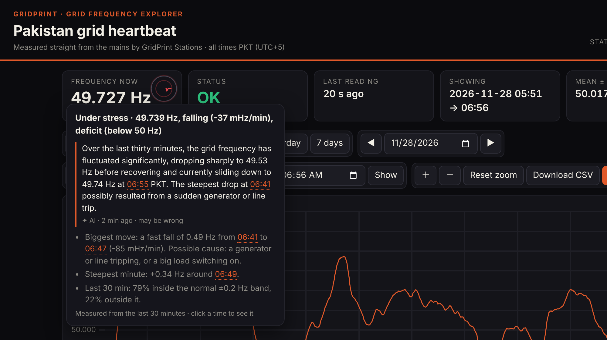
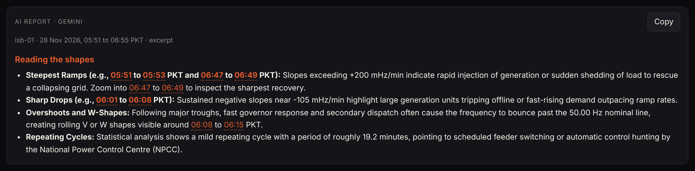
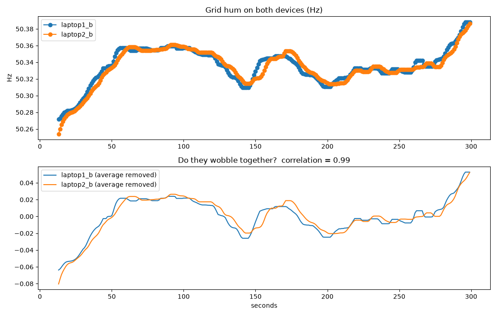

# GridPrint

**Verify when and where a recording was made, using the hum of the power grid.**

Every electrical grid runs at a nominal 50 Hz (60 Hz in the Americas), but the real frequency wanders slightly from second to second as demand changes. That wander is shared across the whole grid and can't be faked after the fact. Recordings made near mains electricity quietly capture it, through lights, fans, transformers and chargers. GridPrint extracts that hidden "grid fingerprint" from audio and video and matches it against a reference log to check a recording's time and place.

Built for [Hack Club Crossroads](https://crossroads.hackclub.com).

## Status

**Phase 1: a live reference station.** GridPrint Station isb-01 measures Pakistan's grid frequency straight from a mains socket in Islamabad once per second and uploads it to a private web explorer every 5 seconds.

- Phase 0 (done): a cheap laptop mic can hear the grid. Two laptops on different floors tracked the same frequency for 5 minutes (correlation 0.99), and quiet phone videos carry it too.
- Phase 1 (live since 28 Nov 2026): a hardware reference station logs the "true" grid frequency, so any recording can be checked against it.



*Real data from Station isb-01, 28 Nov 2026, 05:51 to 06:56 PKT. Hovering shows the exact moment: the grid fell to 49.49 Hz at 06:47.*

| Live insight orb | AI report (excerpt) |
|---|---|
|  |  |

## How it fits together

```
mains socket -> 230/12 V transformer -> PC817 optocoupler -> Arduino UNO (ATmega328P)
     counts every grid cycle, prints one line per second
  -> ESP8266 (on the same board): stamps real time (NTP), buffers up to ~22 h offline
  -> HTTPS every 5 s -> server (Python, no dependencies)
  -> private web explorer: live graph, history, AI reports, live insight orb
```

## Dev journal

### Day 1 (24 Nov 2026): hum test

- Wrote `hum_test.py`: records audio, computes the spectrum, and tracks the exact hum frequency every second using an STFT with parabolic peak interpolation.
- **50 Hz: nothing.** The laptop mic (Intel Smart Sound array) filters out low frequencies, so the 50 Hz trace was pure noise.
- **100 Hz: a signal.** The second harmonic (100 Hz) showed a steady tone that drifts slowly, which is what grid frequency should look like. 100 Hz is the channel to track from here.
- Turned off Windows "Audio enhancements", since its noise suppression is designed to remove steady hums.
- **Plugged vs unplugged:** both recordings showed the 100 Hz tone. Plugged sat around 50.00 Hz (after halving), unplugged drifted smoothly from about 50.3 down to 50.15 Hz. The hum reaches the mic through the air from the room's wiring, not only through the charger, so unplugging doesn't remove it.
- A fixed spike near 95 Hz appears in both recordings and never moves. Probably a fan or motor, not the grid.

**Full handover context for contributors and new sessions: [PROJECT.md](PROJECT.md).**

**Next:** record on two devices in different places at the same moment. If both hum traces rise and fall together, it's the grid.

### Day 2 (25 Nov 2026): two laptops, two floors

- Added a start timestamp to every recording so recordings from different devices can be lined up.
- Wrote `compare.py`: tracks the 100 Hz hum on two recordings, aligns them in time, and scores how closely they move together.
- **Sanity check first:** the plugged and unplugged recordings from Day 1 (made minutes apart) scored 0.04. No match, as expected. The script doesn't just say yes.
- **The experiment:** my laptop (`laptop1`) in my hostel room and a friend's laptop (`laptop2`) on the floor above, both plugged in, recording at the same time for 2 minutes. His started 15.8 s later; the timestamps line them up.
- **Result:** both laptops heard the same frequency, **50.308 Hz vs 50.301 Hz**, and both climbed together from about 50.28 to 50.36 Hz over the two minutes. Correlation **0.83**. Recordings made minutes apart had given 50.02 and 50.2, so matching numbers on two separate laptops at the same moment points to one shared source: the grid.
- **Bug caught:** the first run said 0.96, but that was inflated. The search window was only +/-1 Hz, so when the grid rose above 50.375 Hz, both traces got stuck at the window edge and looked identical. Widened it to +/-3 Hz.
- **Not there yet:** the second-by-second wiggles don't match (wiggle score about 0). His signal was about 3x weaker than mine, so his fine detail is mostly noise. The devices agree on the slow drift, not yet on the details. Added a "wiggle match" check to `compare.py` so this can't hide again.

**Full handover context for contributors and new sessions: [PROJECT.md](PROJECT.md).**

**Next:**
- Rematch with the weaker laptop right next to a charger or tube light, recording 5 minutes instead of 2. Goal: wiggle match above 0.5.
- Record in Lahore and Islamabad at the same moment. Same national grid, about 300 km apart. If the same drift shows up in both cities, nothing local can explain it.

### Day 3 (26 Nov 2026): grid match confirmed



- Rematch, with three changes: recordings of 5 minutes instead of 2, charger brick next to each laptop's mic, and Audio enhancements off on both.
- **First result: no match (0.02).** Looked like a failure. The raw recordings showed otherwise: `compare.py` measured the hum in 4-second chunks, and with a faint signal each chunk was mostly noise.
- **Fix: 16-second chunks.** Longer chunks let the hum build up over the noise. Also a stronger median filter, and the wiggle check now compares changes every 8 seconds.
- **Result: average hum 50.336 Hz vs 50.335 Hz, correlation 0.96 to 0.99, wiggle match 0.79.** Both laptops trace the same path for 5 minutes: the climb to 50.36, the dip at ~145 s, the bump at ~170 s, the final climb to 50.39.
- **Fake-out check:** sliding one recording 30 to 120 seconds out of line drops the correlation to 0.04 at most. The match only exists when the timing is real.
- Day 2's pair, re-analysed with 16-second chunks, scores 0.99 too.
- **The grid caught a clock error:** the best match is always at a 4-second shift. My two laptops' clocks are about 4 seconds apart.
- **Brick next to the mic made my signal weaker,** about 3x versus Day 2 without it. One run only, but it hints the hum enters mostly through the charging cable, not the brick's magnetic field. To test: brick near vs far.
- **Device tones vs grid:** the second laptop shows tones at exactly 200.000, 300.000 and 400.000 Hz. Round numbers that never move are the laptop's own electronics. The grid never sits exactly on 50.000.

**Full handover context for contributors and new sessions: [PROJECT.md](PROJECT.md).**

**Next:** brick near vs far test, Lahore + Islamabad at the same moment, and an extractor that works on any audio or video file.

### Day 4 (26 Nov 2026, ~3 AM): real phone recordings

Built `extract.py` (any audio or video file in, grid verdict out) and ran it on 8 everyday iPhone recordings:

| Recording | Result |
|---|---|
| WhatsApp voice note, quiet room | no grid |
| WhatsApp voice note, phone charging | no grid |
| Video of a lit wall, sent via WhatsApp | **strong grid** |
| Same video, original .MOV | **strong grid**, identical |
| Video of me talking (WhatsApp and original) | no grid |
| Voice note on the roof, away from wiring | weak tone, probably not the grid |
| Voice note next to the rooftop solar inverter | weak, grid-like |

- **Quiet phone video works.** Recorded at 3:08 AM: the 200 Hz and 300 Hz echoes independently trace the same path (49.70 to 49.95 to 49.88 Hz). Two echoes agreeing in detail is internal proof it's the grid. The grid had dropped to about 49.9 Hz, from about 50.33 at 1:30 AM.
- **WhatsApp compression doesn't destroy it.** The original and the compressed video gave identical results.
- **Voice notes are useless**, even with the phone charging. Their noise suppression is built for speech and wipes the hum.
- **Speech drowns it.** Same spot, same light, but talking: no grid. Biggest engineering problem for real-world video.
- **The roof isn't clean.** A steady tone near 50.3 Hz, present before and after a passing truck, that doesn't match the inverter's 49.90 Hz. Probably a nearby device, not the grid. Outdoors doesn't mean silent.
- **The rooftop inverter (GoodWe hybrid, grid-tied)** held a steady 49.90 Hz, consistent with the grid at that hour.

**Lesson:** a hum only counts as the grid if it matches a reference log recorded at the same moment. WhatsApp voice notes also strip the recording time, so they can't be lined up afterwards.

**Full handover context for contributors and new sessions: [PROJECT.md](PROJECT.md).**

**Next:** reference-station test (laptop logs the grid while the phone records), then work on speech: analysing gaps between words, filtering voice harmonics, and reading the light flicker in the picture.

### Day 5 (26 to 27 Nov 2026): GridPrint Station v0

A laptop mic only hears the grid faintly. To check recordings properly, GridPrint needs a reference log of the real grid frequency, so I built a station that measures it directly from the mains.

- **Power side:** a boxed 230 V to 12 V transformer with a 375 mA fuse. It measures 14.4 V AC with no load. Everything after it is low voltage and safe to touch.
- **Sensor:** the transformer's AC drives the LED inside a PC817 optocoupler through a 3.3 kOhm resistor, with a 1N4007 diode across the LED to protect it on the negative half-cycle. The optocoupler's transistor pulls Arduino pin 2 to ground once per grid cycle. Mains and Arduino never touch electrically.
- **Brain:** an Arduino UNO + WiFi clone (ATmega328P + ESP8266 on one board, CH340 USB). `gridprint_station_uno.ino` counts cycles with an interrupt, works out the frequency from their exact timing, and prints `seconds,frequency_hz,pulses,avg_pulse_width_us,status,d2_low_pct` every second. Status is OK, GLITCH (missing or extra cycles) or OUTAGE.
- **Uplink:** `gridprint_uplink.ino` runs on the ESP8266. It stamps each line with real time from NTP, sends 5-second packets over HTTPS, and when Wi-Fi drops it saves readings to flash in 10-minute files (about 22 hours) and uploads the backlog oldest-first when it's back.
- **Dead PC817 #1:** the first optocoupler never switched. Swapped it.
- **USB gotchas:** a charge-only cable ("Device Descriptor Request Failed"), CH340 drivers, and the board's DIP switches, which decide whether USB talks to the ATmega or the ESP8266.
- **Server:** `server/gridprint_server.py`, standard-library Python, hosted on PythonAnywhere for now (moving to Hack Club Nest once approved). Daily CSV files per station, downsampling so a week loads instantly.

### Day 6 (27 to 28 Nov 2026): a private explorer, then six hours chasing a loose wire

**The web explorer** (all in `server/`):

- **Login only.** Three accounts (two admins, one view-only guest), no sign-up page. Passwords stored only as PBKDF2 hashes, sessions as hashed tokens in HttpOnly cookies, lockout after repeated wrong passwords, CSRF checks, a strict content security policy. 80 automated security checks pass, including URL tricks like `/data/../../`.
- **Interactive graph** (uPlot): hover shows the exact time and frequency, a range slider, gentle scroll zoom that can't get lost, outage shading, any day or custom range, CSV export.
- **AI reports (Gemini):** the server first measures the shape of the data itself (turning points, every rise and fall with its slope, the steepest minutes, repeating cycles, sunrise and sunset) and Gemini turns that into a story of what the grid did and why. Every time in the report is clickable and jumps the graph there.
- **Live insight orb:** a small animated heartbeat icon whose colour shows the grid's mood (calm, active, stressed). Hover it for a 30-second summary of the last half hour and the likely cause of the biggest change.

**The bug hunt.** At 10:28 PM the station suddenly reported OUTAGE, even though the power was on.

- The data showed the pulses stretching from 10.4 ms to 16 to 19 ms over a minute, then vanishing. Not how a power cut looks.
- I added a diagnostic: the Arduino now reports what share of each second pin 2 is LOW (`d2_low_pct`). About 50 is healthy, about 100 means stuck LOW, about 0 means stuck HIGH. The server labels every outage with its likely cause: power cut, sensor fault, or loose wire.
- Stuck at 100 with the transformer unplugged meant the problem was on the output side. **The 5 V wire feeding the 10 kOhm pull-up resistor had come loose.**
- A floating pin picks up mains hum through the air and through your fingers, which produced fake but convincing 50 Hz readings and fooled us more than once.
- Reconnecting the wire put it in the wrong row, and a resistor of the wrong value turned up too.
- **Fix:** no external pull-up any more. One word in the code (`INPUT_PULLUP`) uses the ATmega's built-in ~35 kOhm pull-up, so that wire can't come loose again. **Station live at 05:51 AM.**

**First real observations:**

- On the evening of 27 Nov the grid swung between about 49.55 and 50.52 Hz in cycles of 10 to 15 minutes. The European grid usually stays within about +/-0.05 Hz.
- At 06:08 AM on 28 Nov it dropped to 49.69 Hz, then recovered to 50.35 Hz within five minutes: the shape of a sudden loss of generation followed by reserves overshooting.
- Readings between 10:28 PM on 27 Nov and 05:51 AM on 28 Nov are hardware faults, not grid events.

## Roadmap

1. **Prove the match (next):** record a phone video while the station logs, and show the video's hum lines up with the station to the second.
2. **A time-finding tool:** give it a recording and it searches the station's history for where the hum fits, then reports the time with a confidence score.
3. **Second station in Lahore:** same national grid, about 300 km away. If both stations agree, nothing local can explain it, and a recording can be placed on the national grid.
4. **Speech-proof extraction:** pull the hum out from between words and from light flicker in video.
5. **Public demo:** a page where anyone can upload a clip and see whether, and when, it matches the grid.

## The tools

- `hum_test.py`: record from the mic and plot the hum.
- `compare.py`: do two recordings made at the same moment share the same grid wobble?
- `extract.py`: is the grid hiding in this file? Works on WhatsApp voice notes, phone videos, .mp3, .m4a, .mp4 and more. Checks five grid echoes (100 to 300 Hz) and gives a verdict: strong, weak or none.
- `gridprint_core.py`: the shared engine (loading any file, tracking the hum, judging it).
- `gridprint_station_uno/`: Arduino firmware for the station's ATmega328P (measures the grid every second).
- `gridprint_uplink/`: ESP8266 firmware (real time, offline buffer, HTTPS uploads). Copy `secrets.example.h` to `secrets.h` and fill in your Wi-Fi and server details; `secrets.h` never goes to GitHub.
- `server/gridprint_server.py`: the backend and web explorer. Run `python3 server/gridprint_server.py hash` to make a password hash for a new account.

## Run it

```
python -m pip install numpy scipy matplotlib sounddevice imageio-ffmpeg
python hum_test.py
python compare.py laptop1 laptop2
python extract.py any_audio_or_video.mp4
```

Keep the room quiet while it records.
